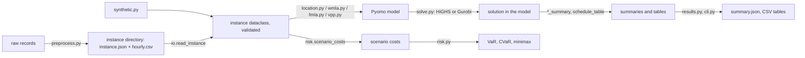

# Software architecture

## Data flow

## Modules (`src/sc_microgrid/`)

| Module | Content |
|---|---|
| `instances.py` | `FixedChargeInstance`, `WarehouseInstance`, `SupplyChainInstance`, `VPPInstance`, and the shared `Technology`, `Storage`, `Truck`; every `validate()` checks names, keys, shapes, finiteness and ranges |
| `io.py` | `write_instance`, `read_instance`: `instance.json` and `hourly.csv`, with unknown-key and complete-grid checks |
| `location.py` | `build_fixed_charge`, `fixed_charge_summary` (Part A) |
| `wmla.py` | `build_wmla` (formulations `"big_m"` and `"bilinear"`, optional fixed open sites), `feasible_open_sets`, `solve_enumerated`, `wmla_summary` (Part B) |
| `fmla.py` | `build_fmla` (big-value form; options `integer_flows`, `no_microgrid`), `scale_cf`, `with_cf`, `expected_cf`, `z_value`, `fmla_summary` (Part C) |
| `risk.py` | `var_model`, `cvar_model`, `minimax_model`, the closed forms, `expected_value`, `risk_table`, `scenario_costs` (Part D) |
| `vpp.py` | `day_ahead`, `intraday`, `rolling_horizon`, `schedule_table` (Part E) |
| `solve.py` | `solve` (HiGHS by default, Gurobi optional; raises `SolveError` unless optimal), `model_size` |
| `preprocess.py` | `wind_cf`, `pv_cf`, `to_periods`, `demand_statistics`, `tou_profile` |
| `synthetic.py` | invented example instances for every model, `synthetic_cf_scenarios`, `capital_recovery_factor` |
| `results.py` | JSON-safe summaries, tables from tuple-keyed results |
| `cli.py` | the `sc-microgrid` command: `synthetic`, `run`, `risk` |

Model components are named after the equations they implement (`eq17_factory_energy`, `eq4_52_energy_balance`, `eq3_12_power_balance`, …), so a constraint in a solver log or an infeasibility report can be traced to [formulation.md](formulation.md).

## Why Pyomo

The models mix binary and integer location and flow decisions with hourly continuous operation, and the bilinear form of the two-tier model multiplies binaries with other variables. Pyomo expresses both the linear and the bilinear forms with the same code, and passes the models in memory to HiGHS or Gurobi through its solver interfaces.

## Solvers

| Model | HiGHS (default, open source) | Gurobi (optional, licence needed) |
|---|---|---|
| fixed charge, WMLA big-M, WMLA enumeration, FMLA, risk models, VPP | yes | yes |
| WMLA bilinear with free location binaries | no (`solve` raises `SolveError`; use the enumeration) | yes, with `options={"NonConvex": 2}` |

`solve(m, solver, mip_gap=1e-6, time_limit=None, threads=None, options=None)` passes `options` to the solver unchanged (HiGHS or Gurobi option names). Mixed-integer objectives are optimal up to the relative `mip_gap`.

## Problem size

Three-tier model with $K$ factories, $N$ warehouses, $S$ stores, $I$ products, $R$ resources, $G$ technologies, $J$ periods of $T$ hours:

- binary variables: $K + N + IJKN + INS$;
- integer variables: $IJKN + IJNS + I(J+1)N + IJN$;
- hourly continuous variables: $J(K+N)(3T + 1)$ (storage level, sale, purchase), plus $(K+N)(G+1)$ capacities;
- constraints: dominated by the $J T (K+N)$ energy balances and, in the big-value form, the $2JT(K+N)$ trade bounds and $JT(K+N)$ storage bounds.

Measured on a laptop (Apple M-series, Python 3.12, Pyomo 6.10, HiGHS 1.15):

| Instance | Variables (integer) | Constraints | Build | Solve |
|---|---|---|---|---|
| synthetic FMLA, 3F-2W-3S, 2 products, 4 periods × 24 h | 1,672 (197) | 2,174 | < 1 s | about 2 s with HiGHS |
| synthetic FMLA, 3F-2W-3S, 2 products, 52 periods × 168 h | 133,624 (2,309) | 177,518 | about 1 s | about 30 s with Gurobi 13 (gap 1e-4); HiGHS stopped at a 20-minute limit with a gap of about 10 % |
| synthetic WMLA, 3 warehouses, 5 stores, 8,736 h | 78,654 (18) | 78,668 | < 1 s | about 11 s with HiGHS |

Mixed-integer solve times depend strongly on the data and the solver. For full-year three-tier instances, Gurobi is markedly faster than HiGHS in these tests; HiGHS handles the reduced horizons, the two-tier model and the VPP comfortably.

For large three-tier instances, a short horizon with `horizon_weight` (for example a few representative weeks) is a practical screening step; the full year is then solved for the selected cases.

## Output tables (`sc-microgrid run`)

| File | Content |
|---|---|
| `summary.json` | total cost, cost components (they add up to the objective), open sites, assignments, capacities (MW), storage (MWh), energy bought and sold (MWh), solver status, objective, bound, run time, model size |
| `capacity_mw.csv` | installed capacity per site and technology (WMLA, FMLA) |
| `production_items.csv` | production per product, period and factory (FMLA) |
| `open_sets.csv` | cost of every open-warehouse set (WMLA with `--enumerate`) |
| `day_ahead.csv`, `intraday.csv`, `rolling_horizon.csv` | hourly VPP schedules; the rolling-horizon table has the hourly cost of the implemented decisions |
| `scenario_costs.csv`, `risk.csv`, `scenario_summaries.json` | `sc-microgrid risk`: cost and design per scenario, VaR, CVaR, minimax and expected cost per confidence level |

All costs are in \$ (per year for the planning models, with `horizon_weight` applied).

## Tests (`tests/`)

- instance validation: negative, non-finite, missing and unknown entries, shapes, ranges, duplicate names;
- input format: round trip of every model, site names kept as text ("001", "NA"), unknown keys, incomplete hourly grids, missing columns;
- fixed charge: optimum equal to a brute-force enumeration of all assignments;
- WMLA: big-value optimum equal to the enumerated bilinear optimum on four synthetic cases (and to the direct bilinear solve with Gurobi, when available); energy balances recomputed from the solution; storage full at start and end; no microgrid at closed sites; components add up to the objective; open sites given as an iterator; the enumeration stops with an error when a subproblem is not solved to optimality or proven infeasible;
- FMLA: energy balances (17) and (22) recomputed from the solution; service level (35); integer flows; no backorder in the last period; storage start and end; no production at closed factories; grid-only and relaxed cases bound the base case; a `big_m` below the capacity bound is refused; scenario helpers, including invalid or mis-shaped scenario capacity factors;
- risk: VaR, CVaR and minimax models equal the closed forms over a range of confidence levels; known values; invalid inputs, including a VaR `big_m` below the cost range;
- VPP: day-ahead and intraday balances with fixed sales; a rolling horizon with a full-day window and delivery-day values equals the intraday optimum; storage continuity between windows; initial storage within capacity; the spill extension and its price condition;
- preprocessing helpers, the command line and the minimal example.

The test of the direct bilinear WMLA solve needs Gurobi and is skipped when it is not installed.
