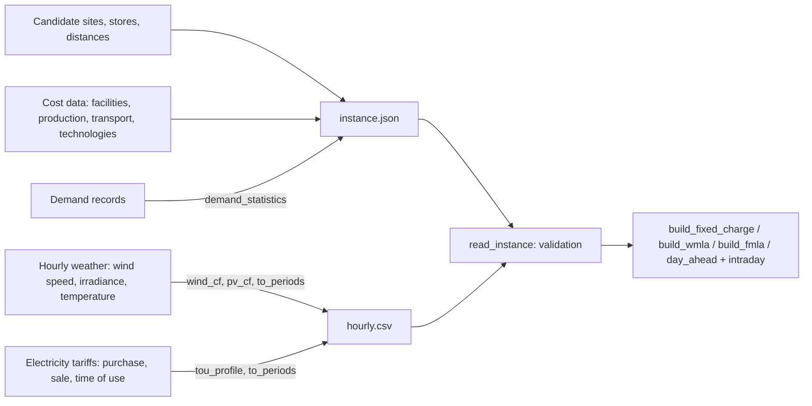

# Data pipeline and input schemas

This document describes how the inputs of each model are prepared and the format in which the framework reads them. It describes structure only; the repository ships no real data. The synthetic generators in [`synthetic.py`](../src/sc_microgrid/synthetic.py) produce complete example inputs in this format, and [`examples/prepare_inputs.py`](../examples/prepare_inputs.py) runs the weather-to-capacity-factor steps on invented records.

## Overview



| Input group | Used by | Typical sources |
|---|---|---|
| Candidate sites, store locations, distances | A, B, C | company network data; road or great-circle distances between site coordinates |
| Facility fixed costs, capacities | A, B, C | real-estate and construction cost studies, annualized with a capital recovery factor |
| Production cost, energy per item, resource use and availability | C | plant engineering data (labour hours, machine hours, energy intensity per item) |
| Holding, backorder and shipping costs | A, B, C | logistics cost data |
| Demand statistics | C (mean and standard deviation), A and B (horizon totals) | sales records per product, store and period |
| Hourly capacity factors | B, C | hourly wind speed and solar irradiance records of each candidate site, converted with a power curve and a PV model |
| Electricity prices | B, C, E | utility tariffs (flat or time-of-use), feed-in or net-metering rates, day-ahead and imbalance market prices |
| Technology costs | B, C | technology cost reports (capacity cost, fixed and variable O&M), carbon credit schemes |
| Truck data | B, C | vehicle self-weight and energy intensity (MWh per kg and km) |
| VPP loads, heat loads, renewable output | E | site metering and forecasts (day-ahead forecasts and delivery-day values) |

## Steps

### 1. Network

- List the candidate factories, candidate warehouses and stores with their coordinates. Site names must be unique across factories and warehouses (they share the hourly file).
- Compute distances $d_{kn}$ (factory → warehouse) and $\hat d_{ns}$ (warehouse → store), or $d_{ns}$ in the two-tier and fixed-charge models, in km.
- Choose the production period (a week in AMM 2023, $T = 168$ h) and the number of periods $J$. A year of 52 weekly periods has 8,736 hours.

### 2. Costs and capacities

- Annualize one-time costs with the capital recovery factor $\phi = r(1+r)^n / ((1+r)^n - 1)$ (`capital_recovery_factor(rate, years)`) for the discount rate $r$ and the lifetime $n$. Facility costs $F_k$, $\hat F_n$ are entered already annualized; technology and storage capacity costs are entered as one-time costs with their own $\phi_g$, $\phi_{ES}$.
- Production cost per item excludes energy, which the model buys or generates.
- Holding and backorder costs are per item and period; shipping costs per item and km.
- Warehouse capacity $\gamma_{in}$ is per product and period (three-tier model) or for the horizon (two-tier and fixed-charge models).

### 3. Demand

- From sales records with one row per product, store, period of the year and historical year, `demand_statistics` returns the mean and the standard deviation per (product, period, store).
- The service level $\alpha$ sets the safety stock through $z_\alpha$ in Eq. (35).
- The two-tier and fixed-charge models take one demand total per store for the horizon.

### 4. Production resources and energy

- Resource use $w_{ikr}$ and availability $W_{jkr}$ in consistent units (for example labour hours and machine hours per period).
- Energy per item $e_{ik}$ in MWh; base load of an open factory $L_k$ and power demand of a warehouse $\hat L_n$ in MW.
- Trucks: self-weight $m_{EV}$ (kg) and energy intensity $q_{EV}$ (MWh per kg and km); trip rates between the tiers in trips per hour (for one round trip per day, $1/24$).

### 5. Capacity factors

For each candidate site, from hourly weather records of several years:

1. Clean the records: remove duplicates, fill short gaps by interpolation, flag long gaps.
2. Wind: scale the measured wind speed to hub height with a power law, then apply a power curve. `wind_cf` uses a generic curve (0 below cut-in, cubic rise to rated speed, 1 up to cut-out, 0 above); a manufacturer's curve can be used instead.
3. PV: convert irradiance to a capacity factor relative to 1,000 W/m² and derate for cell temperature (`pv_cf`, NOCT approximation).
4. Build one representative year per site, for example the hour-by-hour average over the years, or a typical meteorological year.
5. Cut the year into $J$ periods of $T$ hours (`to_periods`).

AMM 2023 and the thesis estimated hourly capacity factors for every candidate city from about a decade of hourly weather records (AMM 2023 Section 4.1). Any source of hourly wind speed and irradiance can be used. Check its terms of use before sharing derived series.

### 6. Electricity prices

- Purchase prices: flat or time-of-use (`tou_profile`); sale prices: feed-in or net-metering rates. Prices may differ by site.
- VPP: day-ahead market prices for the forecast day, and an imbalance (penalty) price for energy bought on the delivery day.

### 7. Capacity-factor scenarios (thesis Chapter 5)

Scenarios can be built from the historical spread of the capacity factors, for example a low, a medium and a high year, or by scaling the representative series. `scale_cf` scales every series and caps it at 1; `expected_cf` forms the probability-weighted series of Model 5.1; `scenario_costs` solves the model once per scenario.

### 8. VPP inputs

- Day-ahead forecasts of the electrical load, the thermal load and the renewable output (thesis Chapter 2 discusses load forecasting with recurrent neural networks; any forecaster can be used), and the delivery-day values.
- CHP limits and heat-to-power ratio, battery and thermal storage limits, fuel and storage operating costs.

## Data preparation rules and QA checks

`read_instance` and the `validate` methods enforce the checks marked ✓; the others are worth running when preparing data.

| Check | |
|---|---|
| every input finite; costs, capacities, distances and loads non-negative | ✓ |
| capacity factors within [0, 1]; operating shares within [0, 1]; capital recovery factors within [0, 1] | ✓ |
| hourly files complete: every site × period × hour exactly once, no unknown columns | ✓ |
| names unique; factories and warehouses distinct; every table has exactly the expected keys | ✓ |
| service level strictly between 0 and 1; VPP lower limits not above upper limits | ✓ |
| total capacity of the candidate warehouses covers the total demand (two-tier and fixed-charge models) | ✓ |
| total production resources of all factories cover the demand plus safety stock in every period | – |
| $M$ larger than every quantity it bounds, but not by orders of magnitude ([formulation.md](formulation.md#conventions-of-this-implementation)) | – |
| the unclipped maximum of each capacity-factor series: values above 1 point to a unit or capacity error | – |
| purchase price at least the sale price in every hour, unless arbitrage is intended | – |
| VPP: heat load reachable with the CHP limits and the heat-to-power ratio; delivery-day surpluses fit the storage, or use the spill extension | – |

## Input directory format

An instance is a directory with `instance.json` and, for the hourly models, `hourly.csv`. `write_instance(inst, directory)` writes it; `read_instance(directory)` reads and validates it. Key names carry their units; unknown or missing keys are refused.

### `instance.json`, common blocks (models `wmla`, `fmla`)

```json
"technologies": {"<g>": {"capacity_cost_usd_per_mw": 0, "capital_recovery_factor": 0, "om_cost_usd_per_mwh": 0,
                         "carbon_credit_usd_per_mwh": 0, "operating_hours_per_step": 1}},
"storage": {"capacity_cost_usd_per_mwh": 0, "capital_recovery_factor": 0, "maintenance_cost_usd_per_mwh": 0},
"truck": {"weight_kg": 0, "energy_mwh_per_kg_km": 0}
```

### Model `fixed_charge` (Part A)

| Key | Shape | Unit |
|---|---|---|
| `sites`, `stores` | list of names | – |
| `fixed_cost_usd`, `capacity_items` | {site: value} | \$, items |
| `demand_items` | {store: value} | items |
| `ship_cost_usd_per_item_km`, `distance_km` | {site: {store: value}} | \$/item/km, km |

### Model `wmla` (Part B)

| Key | Shape | Unit |
|---|---|---|
| `sites`, `stores`, `hours` | lists, integer $T$ | – |
| `fixed_cost_usd`, `capacity_items`, `site_load_mw` | {site: value} | \$/yr, items, MW |
| `demand_items` | {store: value} | items over the horizon |
| `ship_cost_usd_per_item_km`, `distance_km` | {site: {store: value}} | \$/item/km, km |
| `product_weight_kg` | number | kg/item |
| `max_capacity_mw` | {site: {technology: value}} | MW |
| `big_m`, `horizon_weight` | numbers (optional) | – |

`hourly.csv`: columns `hour` (1..T), `site`, `cf_<technology>` for every technology, `buy_price_usd_per_mwh`, `sell_price_usd_per_mwh`, `operating_share`.

### Model `fmla` (Part C)

| Key | Shape | Unit |
|---|---|---|
| `factories`, `warehouses`, `stores`, `products`, `resources` | lists of names | – |
| `periods`, `hours` | integers $J$, $T$ | – |
| `factory_fixed_cost_usd`, `factory_load_mw` | {factory: value} | \$/yr, MW |
| `warehouse_fixed_cost_usd`, `warehouse_load_mw` | {warehouse: value} | \$/yr, MW |
| `production_cost_usd_per_item`, `energy_mwh_per_item` | {product: {factory: value}} | \$/item, MWh/item |
| `holding_cost_usd_per_item_period`, `backorder_cost_usd_per_item_period` | {product: value} | \$/item/period |
| `ship_cost_fw_usd_per_item_km`, `ship_cost_ws_usd_per_item_km`, `product_weight_kg` | {product: value} | \$/item/km, kg/item |
| `resource_use` | {product: {factory: {resource: value}}} | per item |
| `resource_available` | {period: {factory: {resource: value}}} | per period |
| `warehouse_capacity_items` | {product: {warehouse: value}} | items |
| `demand_mean_items`, `demand_std_items` | {product: {period: {store: value}}} | items/period |
| `service_level` | number in (0, 1) | – |
| `distance_fw_km`, `trips_fw_per_hour` | {factory: {warehouse: value}} | km, trips/h |
| `distance_ws_km`, `trips_ws_per_hour` | {warehouse: {store: value}} | km, trips/h |
| `max_capacity_mw` | {site: {technology: value}} | MW |
| `big_m`, `horizon_weight` | numbers (optional) | – |

Periods are written as JSON keys "1", "2", …. `hourly.csv`: columns `period` (1..J), `hour` (1..T), `site` (every factory and warehouse), `cf_<technology>`, `buy_price_usd_per_mwh`, `sell_price_usd_per_mwh`.

### Model `vpp` (Part E)

`instance.json`: `fuel_cost_usd_per_mwh`, `storage_cost_usd_per_mwh`, `heat_to_power`, `chp_min_mw`, `chp_max_mw`, `battery_min_mwh`, `battery_max_mwh`, `thermal_min_mwh`, `thermal_max_mwh`, optional `battery_initial_mwh`, `thermal_initial_mwh`.

`hourly.csv`: `hour` (1..T in order), `load_mw`, `heat_load_mw`, `renewable_mw`, `day_ahead_price_usd_per_mwh`, `imbalance_price_usd_per_mwh`, `load_realized_mw`, `heat_load_realized_mw`, `renewable_realized_mw`.

## Terms of use of the sources

Weather portals, market operators and cost reports have their own terms; some forbid redistribution or derived products. Keep the raw records and the derived series where the terms allow, record the source, the version or access date and checksums, and share recipes rather than data when redistribution is not allowed.
